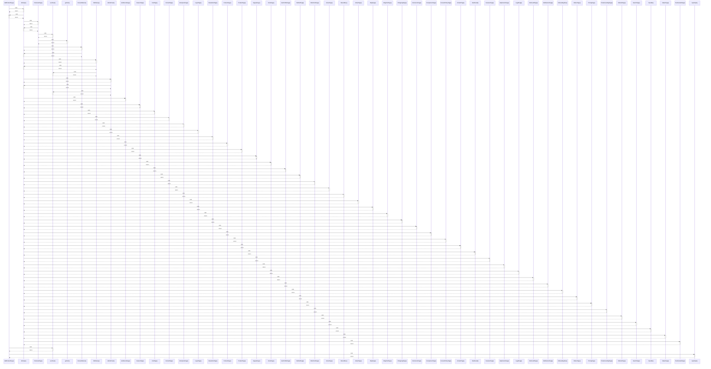

# AddProductPage()

> God node · 4 connections · [C:\Users\alexi\OneDrive\Desktop\project\WePub\src\pages\AddProductPage.jsx](file:///C:/Users/alexi/OneDrive/Desktop/project/WePub/src/pages/AddProductPage.jsx#L40)

## Call Trace Diagram

## Connections by Relation

### calls
- [[btnStyle()]] `INFERRED`
- [[useToast()]] `INFERRED`
- [[inputStyle()]] `EXTRACTED`

### contains
- [[AddProductPage.jsx]] `EXTRACTED`

---

*Part of the graphify knowledge wiki. See [[index]] to navigate.*