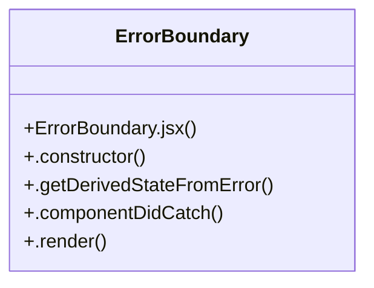

# UI Error Handling

> 6 nodes · cohesion 0.33

## Key Concepts

- [ErrorBoundary](file:///C:/Users/alexi/OneDrive/Desktop/project/WePub/src/components/ErrorBoundary.jsx#L3) (5 connections)
- [ErrorBoundary.jsx](file:///C:/Users/alexi/OneDrive/Desktop/project/WePub/src/components/ErrorBoundary.jsx#L1) (1 connections)
- [.componentDidCatch()](file:///C:/Users/alexi/OneDrive/Desktop/project/WePub/src/components/ErrorBoundary.jsx#L13) (1 connections)
- [.constructor()](file:///C:/Users/alexi/OneDrive/Desktop/project/WePub/src/components/ErrorBoundary.jsx#L4) (1 connections)
- [.getDerivedStateFromError()](file:///C:/Users/alexi/OneDrive/Desktop/project/WePub/src/components/ErrorBoundary.jsx#L9) (1 connections)
- [.render()](file:///C:/Users/alexi/OneDrive/Desktop/project/WePub/src/components/ErrorBoundary.jsx#L17) (1 connections)

## Class Diagram

## Relationships

- No strong cross-community connections detected

## Source Files

- [C:\Users\alexi\OneDrive\Desktop\project\WePub\src\components\ErrorBoundary.jsx](file:///C:/Users/alexi/OneDrive/Desktop/project/WePub/src/components/ErrorBoundary.jsx)

## Audit Trail

- EXTRACTED: 10 (100%)
- INFERRED: 0 (0%)
- AMBIGUOUS: 0 (0%)

---

*Part of the graphify knowledge wiki. See [[index]] to navigate.*