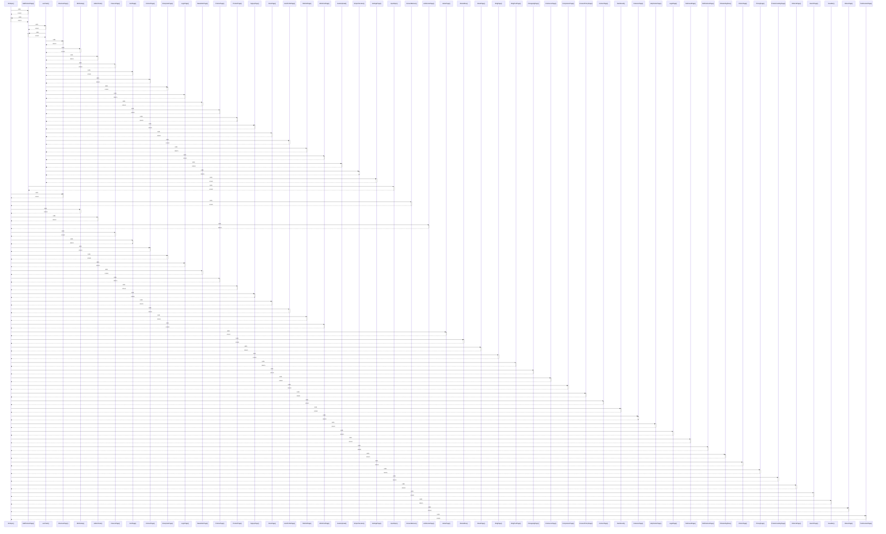

# btnStyle()

> God node · 46 connections · [C:\Users\alexi\OneDrive\Desktop\project\WePub\src\utils.jsx](file:///C:/Users/alexi/OneDrive/Desktop/project/WePub/src/utils.jsx#L1)

## Call Trace Diagram

## Connections by Relation

### calls
- [[AddProductPage()]] `INFERRED`
- [[CheckoutPage()]] `INFERRED`
- [[ConsentBanner()]] `INFERRED`
- [[MFASetup()]] `INFERRED`
- [[AdminPanel()]] `INFERRED`
- [[AuthHomePage()]] `INFERRED`
- [[CareersPage()]] `INFERRED`
- [[CartPage()]] `INFERRED`
- [[ContactPage()]] `INFERRED`
- [[EnterprisePage()]] `INFERRED`
- [[LoginPage()]] `INFERRED`
- [[NewsletterPage()]] `INFERRED`
- [[PartnerPage()]] `INFERRED`
- [[ProductPage()]] `INFERRED`
- [[SignupPage()]] `INFERRED`
- [[StorePage()]] `INFERRED`
- [[UserProfilePage()]] `INFERRED`
- [[WishlistPage()]] `INFERRED`
- [[WritePostPage()]] `INFERRED`
- [[HomePage()]] `INFERRED`

### contains
- [[utils.js]] `EXTRACTED`
- [[utils.jsx]] `EXTRACTED`

---

*Part of the graphify knowledge wiki. See [[index]] to navigate.*