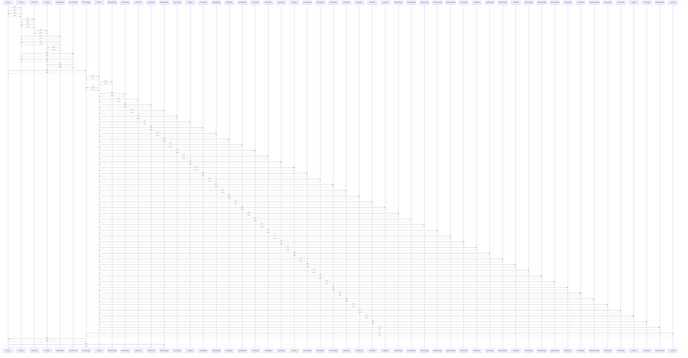

# getCart()

> God node · 4 connections · [C:\Users\alexi\OneDrive\Desktop\project\WePub\src\cartStore.js](file:///C:/Users/alexi/OneDrive/Desktop/project/WePub/src/cartStore.js#L26)

## Call Trace Diagram

## Connections by Relation

### calls
- [[readCart()]] `EXTRACTED`
- [[CheckoutPage()]] `INFERRED`
- [[AuthHomePage()]] `INFERRED`

### contains
- [[cartStore.js]] `EXTRACTED`

---

*Part of the graphify knowledge wiki. See [[index]] to navigate.*