# Knowledge Graph Index

> Auto-generated by graphify. Start here — read community articles for context, then drill into god nodes for detail.

**297 nodes · 321 edges · 39 communities**

---

## System Architecture Flowchart

```mermaid
flowchart TD
    C0["Community 0 (41 nodes)"]
    C1["Community 1 (34 nodes)"]
    C2["unknown (20 nodes)"]
    C3["Community 3 (18 nodes)"]
    C4["Community 4 (12 nodes)"]
    C5["Community 5 (8 nodes)"]
    C6["Community 6 (8 nodes)"]
    C7["Community 7 (8 nodes)"]
    C8["Community 8 (7 nodes)"]
    C9["Community 9 (7 nodes)"]
    C10["Community 10 (7 nodes)"]
    C11["Community 11 (7 nodes)"]
    C12["UI Error Handling (6 nodes)"]
    C13["Community 13 (6 nodes)"]
    C14["Community 14 (6 nodes)"]
    C15["Community 15 (6 nodes)"]
    C16["Community 16 (6 nodes)"]
    C17["Community 17 (6 nodes)"]
    C18["Community 18 (6 nodes)"]
    C19["Community 19 (6 nodes)"]
    C20["Community 20 (6 nodes)"]
    C21["Community 21 (5 nodes)"]
    C22["Community 22 (5 nodes)"]
    C23["Community 23 (5 nodes)"]
    C24["Community 24 (5 nodes)"]
    C25["Community 25 (5 nodes)"]
    C26["Community 26 (4 nodes)"]
    C27["Community 27 (4 nodes)"]
    C28["Community 28 (4 nodes)"]
    C29["Community 29 (4 nodes)"]
    C30["Community 30 (4 nodes)"]
    C31["Community 31 (4 nodes)"]
    C32["Community 32 (4 nodes)"]
    C33["Community 33 (4 nodes)"]
    C34["Community 34 (4 nodes)"]
    C35["unknown (2 nodes)"]
    C36["unknown (1 nodes)"]
    C37["unknown (1 nodes)"]
    C38["unknown (1 nodes)"]
    C1 -->|8 edges| C0
    C1 -->|2 edges| C3
    C5 -->|1 edges| C1
    C1 -->|1 edges| C27
    C1 -->|1 edges| C21
    C1 -->|1 edges| C8
    C1 -->|1 edges| C9
    C1 -->|1 edges| C23
    C1 -->|1 edges| C28
    C1 -->|1 edges| C13
    C1 -->|1 edges| C29
    C1 -->|1 edges| C24
    C1 -->|1 edges| C30
    C1 -->|1 edges| C10
    C1 -->|1 edges| C14
    C1 -->|1 edges| C31
    C1 -->|1 edges| C15
    C1 -->|1 edges| C32
    C1 -->|1 edges| C16
    C1 -->|1 edges| C17
    C1 -->|1 edges| C33
    C1 -->|1 edges| C18
    C1 -->|1 edges| C19
    C1 -->|1 edges| C25
    C1 -->|1 edges| C7
    C1 -->|1 edges| C34
    C1 -->|1 edges| C11
    C1 -->|1 edges| C20
    C0 -->|1 edges| C8
    C0 -->|1 edges| C9
    C0 -->|1 edges| C23
    C0 -->|1 edges| C3
    C0 -->|1 edges| C24
    C0 -->|1 edges| C14
    C0 -->|1 edges| C32
    C0 -->|1 edges| C17
    C0 -->|1 edges| C7
    C0 -->|1 edges| C34
```

## Communities
(sorted by size, largest first)

- [[Community 0]] — 41 nodes
- [[Community 1]] — 34 nodes
- [[unknown]] — 20 nodes
- [[Community 3]] — 18 nodes
- [[Community 4]] — 12 nodes
- [[Community 5]] — 8 nodes
- [[Community 6]] — 8 nodes
- [[Community 7]] — 8 nodes
- [[Community 8]] — 7 nodes
- [[Community 9]] — 7 nodes
- [[Community 10]] — 7 nodes
- [[Community 11]] — 7 nodes
- [[UI Error Handling]] — 6 nodes
- [[Community 13]] — 6 nodes
- [[Community 14]] — 6 nodes
- [[Community 15]] — 6 nodes
- [[Community 16]] — 6 nodes
- [[Community 17]] — 6 nodes
- [[Community 18]] — 6 nodes
- [[Community 19]] — 6 nodes
- [[Community 20]] — 6 nodes
- [[Community 21]] — 5 nodes
- [[Community 22]] — 5 nodes
- [[Community 23]] — 5 nodes
- [[Community 24]] — 5 nodes
- [[Community 25]] — 5 nodes
- [[Community 26]] — 4 nodes
- [[Community 27]] — 4 nodes
- [[Community 28]] — 4 nodes
- [[Community 29]] — 4 nodes
- [[Community 30]] — 4 nodes
- [[Community 31]] — 4 nodes
- [[Community 32]] — 4 nodes
- [[Community 33]] — 4 nodes
- [[Community 34]] — 4 nodes
- [[unknown]] — 2 nodes
- [[unknown]] — 1 nodes
- [[unknown]] — 1 nodes
- [[unknown]] — 1 nodes

## God Nodes
(most connected concepts — the load-bearing abstractions)

- [[btnStyle()]] — 46 connections
- [[useToast()]] — 21 connections
- [[readCart()]] — 5 connections
- [[writeCart()]] — 5 connections
- [[sendEmail()]] — 5 connections
- [[ErrorBoundary]] — 5 connections
- [[getCart()]] — 4 connections
- [[sendOrderConfirmation()]] — 4 connections
- [[AddProductPage()]] — 4 connections
- [[CheckoutPage()]] — 4 connections

---

*Generated by [graphify](https://github.com/safishamsi/graphify)*