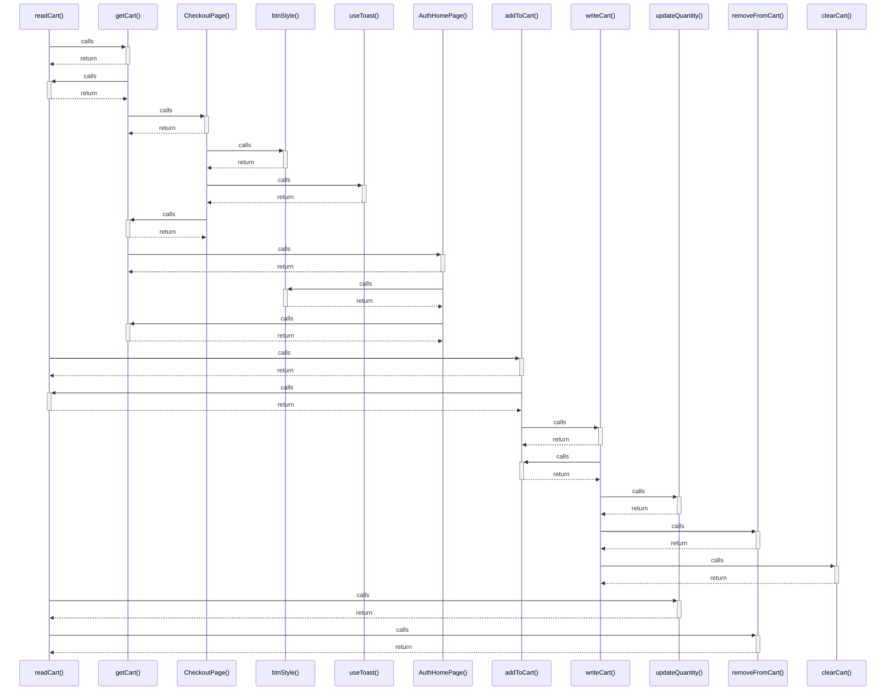

# readCart()

> God node · 5 connections · [C:\Users\alexi\OneDrive\Desktop\project\WePub\src\cartStore.js](file:///C:/Users/alexi/OneDrive/Desktop/project/WePub/src/cartStore.js#L8)

## Call Trace Diagram

## Connections by Relation

### calls
- [[getCart()]] `EXTRACTED`
- [[addToCart()]] `EXTRACTED`
- [[updateQuantity()]] `EXTRACTED`
- [[removeFromCart()]] `EXTRACTED`

### contains
- [[cartStore.js]] `EXTRACTED`

---

*Part of the graphify knowledge wiki. See [[index]] to navigate.*