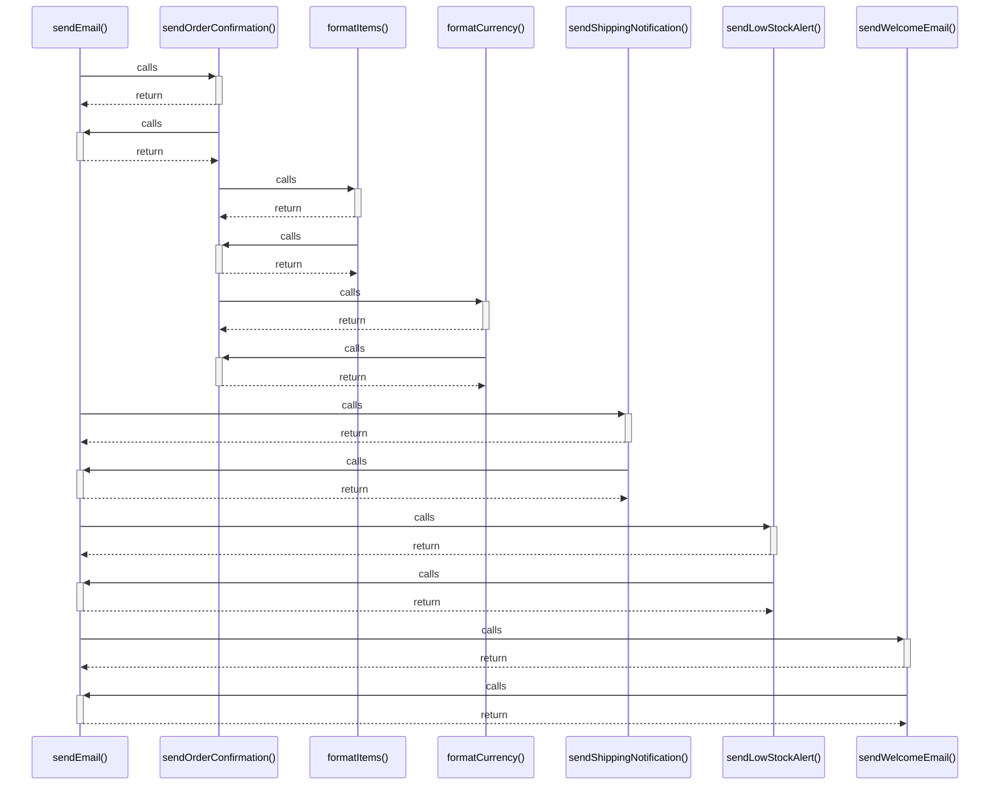

# sendEmail()

> God node · 5 connections · [C:\Users\alexi\OneDrive\Desktop\project\WePub\src\emailNotifications.js](file:///C:/Users/alexi/OneDrive/Desktop/project/WePub/src/emailNotifications.js#L24)

## Call Trace Diagram

## Connections by Relation

### calls
- [[sendOrderConfirmation()]] `EXTRACTED`
- [[sendShippingNotification()]] `EXTRACTED`
- [[sendLowStockAlert()]] `EXTRACTED`
- [[sendWelcomeEmail()]] `EXTRACTED`

### contains
- [[emailNotifications.js]] `EXTRACTED`

---

*Part of the graphify knowledge wiki. See [[index]] to navigate.*