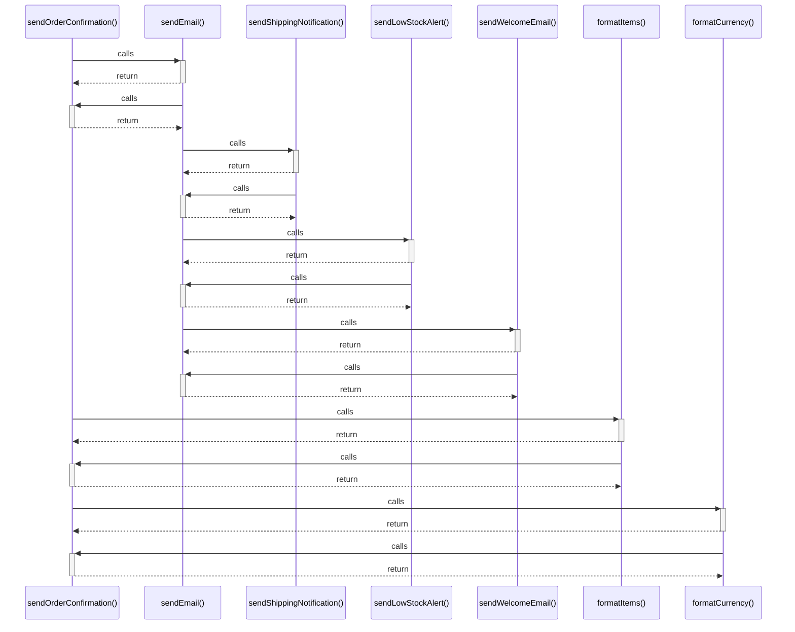

# sendOrderConfirmation()

> God node · 4 connections · [C:\Users\alexi\OneDrive\Desktop\project\WePub\src\emailNotifications.js](file:///C:/Users/alexi/OneDrive/Desktop/project/WePub/src/emailNotifications.js#L42)

## Call Trace Diagram

## Connections by Relation

### calls
- [[sendEmail()]] `EXTRACTED`
- [[formatItems()]] `EXTRACTED`
- [[formatCurrency()]] `EXTRACTED`

### contains
- [[emailNotifications.js]] `EXTRACTED`

---

*Part of the graphify knowledge wiki. See [[index]] to navigate.*